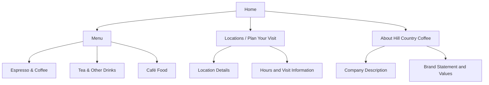

# Hill Country Coffee — Client Project Plan

**WebWorks Studio**  
**Week 13: Client Sprint 1 — Discovery & Planning**

**Student:** [Your Name]  
**Date:** [Submission Date]

> This plan is based on the supplied client brief, approved content, personas, asset notes, and course requirements. Missing client information is identified as a dependency rather than invented.

> **Week 13 boundary:** This document defines the problem, users, content, requirements, scope, technical direction, and production plan. It does not include production code, wireframes, visual comps, or page layouts.

---

# 1. Client & Project Summary

Hill Country Coffee is an independent regional coffee company based in Central Texas. It offers espresso drinks, brewed coffee, cold beverages, teas, and a rotating selection of café food. The client needs a modern, responsive website because its current online information has become inconsistent, difficult to scan on mobile devices, and harder for customers to navigate. The site will serve local regulars, people looking for a café while out in the area, visitors exploring the Texas Hill Country, and customers reviewing offerings before visiting. The central problem is to make the business, menu, and visit information clear and easy to find while communicating the company's welcoming, local character. The project will prioritize mobile usability, understandable navigation, accurate approved content, accessibility, and a manageable course-scale implementation.

# 2. Prioritized Business Goals

## Goal 1 — Highest Priority: Make visit information easy to find

**Goal:** Help customers quickly locate café/location information and confirm visit details, especially on mobile devices.

**Why it matters:** Customers need practical information before deciding where and when to visit. The client specifically identifies location and hours as difficult-to-find information and names mobile usability as a priority.

**Evidence from the brief:** The client says location and hours should be easy to find and that customers sometimes have trouble finding basic information quickly. Maya needs opening hours and nearby café information; Daniel needs location information while planning a day trip.

## Goal 2: Make the menu and offerings easy to understand

**Goal:** Give visitors a clear, scannable overview of the available drink and food categories.

**Why it matters:** Customers should be able to review the general offerings before visiting without struggling through dense copy, tiny documents, or images containing essential text.

**Evidence from the brief:** The client says the menu should be easy to scan. The approved content supplies Espresso & Coffee, Tea & Other Drinks, and Café Food categories. Maya wants to check familiar options, while Daniel and Renee want to understand the general menu before choosing to visit.

## Goal 3: Communicate the brand and local identity clearly

**Goal:** Help first-time visitors understand what Hill Country Coffee is and what makes its café experience distinctive.

**Why it matters:** Visitors who do not already know the business need enough concise, accurate information to decide whether it fits their plans. This goal supports the client’s brand and community priorities without making the site complicated.

**Evidence from the brief:** The client wants the site to communicate what makes the company distinctive and its connection to the Texas Hill Country. Approved content describes quality ingredients, careful preparation, welcoming spaces, neighborly service, and community.

# 3. Target Users & User Needs

## Maya — Mobile Regular

**Context:** Maya lives in the area, visits several times each month, and usually checks the website on her smartphone while already out.

**Primary goal:** Confirm practical visit details and check whether familiar drinks or food options are offered.

**Important information/tasks:** Opening hours, café/location information, menu categories, and concise details that can be scanned quickly.

**Likely friction:** Hours buried in the site, unclear navigation labels, long promotional content before useful information, and menu content that is hard to scan on a small screen.

**Design/accessibility implication:** Prioritize clear navigation, easy-to-find visit information, readable text, concise content, predictable page structure, and touch-friendly controls. The site should not require visitors to read long blocks of promotional copy before reaching practical information.

## Daniel — Hill Country Visitor

**Context:** Daniel is visiting Central Texas and searches online for local coffee shops while planning a day trip. He may enter the website from a search result rather than the homepage.

**Primary goal:** Understand the business, review its general offerings, and find enough location information to decide whether to visit.

**Important information/tasks:** A concise company introduction, menu categories, location details, hours when confirmed, and meaningful photography when approved assets become available.

**Likely friction:** Content that assumes prior knowledge, location information without useful context, unclear navigation labels, or important information embedded only in images.

**Design/accessibility implication:** Each page should make sense as a possible entry point. Use familiar, descriptive labels and keep essential information in real HTML text. Approved imagery may support the brand, but it must not be the only way to understand the business.

## Renee — The Deliberate Planner

**Context:** Renee enjoys meeting friends at local cafés and reviews options before choosing a location. She uses desktop and mobile devices and may enlarge text.

**Primary goal:** Compare the menu and business information, understand the café's atmosphere and values, and share useful information before planning a visit.

**Important information/tasks:** Menu categories and available descriptions, company/about information, location and visit details, and shareable page links.

**Likely friction:** Small or low-contrast text, layouts that break when enlarged, menus presented only as tiny PDFs or images, and vague link labels.

**Design/accessibility implication:** Use readable contrast, meaningful headings, descriptive links, flexible layouts, and content that remains usable when browser text is enlarged. Avoid making essential menu information dependent on PDF or image-only content.

# 4. User-Need Statements

## Maya

Maya needs a way to quickly check café hours, location information, and familiar menu options on her phone so that she can make a confident visit decision while she is already out.

## Daniel

Daniel needs a way to understand what Hill Country Coffee offers and find clear location information so that he can decide whether the café fits into his Central Texas visit.

## Renee

Renee needs a way to review organized menu and company information using readable, flexible content so that she can compare options and plan or share a café visit with friends.

# 5. Priority User Tasks

| Priority | User Task | Primary Persona(s) | Why It Matters |
|---|---|---|---|
| 1 | Find café/location information and confirmed visit details | Maya, Daniel, Renee | Location and hours are explicit client priorities and essential to planning a visit. |
| 2 | Scan the available drink and food categories | Maya, Daniel, Renee | The client wants the menu to be easy to scan; all three personas use menu information. |
| 3 | Understand what Hill Country Coffee is and what makes it distinctive | Daniel, Renee | First-time visitors need context; the client wants the brand and local connection communicated. |
| 4 | Navigate directly to Menu, Locations/Visit, and About information | All personas | Familiar, clear navigation reduces friction and supports visitors arriving on different pages. |
| 5 | Read, enlarge, and share useful information across devices | Renee, Daniel, Maya | Flexible content and responsive behavior support planning, accessibility, and mobile use. |

# 6. Content Inventory & Organization

| Content / Proposed Section | Primary Purpose | Primary User Task | Supplied Content / Assets | Missing / Needed | MVP or Future |
|---|---|---|---|---|---|
| Home / introductory content | Introduce the company and direct visitors to key information | Understand the business; navigate to Menu or Visit | Approved company description, brand statement, approved CTA language | Final approved photography and confirmation of final homepage copy | MVP |
| Menu | Explain the main drink and food offerings | Scan drink and food categories before visiting | Espresso & Coffee, Tea & Other Drinks, and Café Food categories and listed examples | Complete descriptions, prices, availability details, dietary/allergen information | MVP with supplied category-level content; detailed menu data is a dependency |
| Locations / Plan Your Visit | Help customers find café information and prepare to visit | Find location and confirm hours/details | Client requirement for location information; approved CTA language such as “Find a Location” and “Plan Your Visit” | Instructor-approved placeholder location details for production; final addresses, hours, phone numbers, and any location-specific details | MVP; content dependency must be resolved before final delivery |
| About Hill Country Coffee | Communicate company identity, values, and local connection | Understand what makes the business distinctive | Approved About content, company values, and brand statement | Final photography; any additional client-approved story details if required | MVP |
| Contact / social information | Provide additional ways to connect if approved details are supplied | Find a contact or social channel | No confirmed contact or social details supplied | Approved email, phone, social links, and decision about whether a separate Contact area is needed | Future unless required details are provided and time permits |
| Photography / supporting imagery | Support the brand and help first-time visitors evaluate the café | Understand the café atmosphere | Asset notes only; no final production imagery supplied in the package | Approved café, product, and location photography; image permissions and alt-text context | Needed only where approved assets are available; do not substitute random images |

## Content Grouping Notes

The MVP should group information around the main visitor questions: “What is this business?”, “What can I order?”, and “Where can I visit?” Home introduces the company and directs visitors to the highest-priority tasks. Menu keeps drink and food categories together so they can be scanned in one predictable place. Locations / Plan Your Visit groups location and confirmed hours because they support the same visit-planning task. About contains the company description, brand statement, and values because they explain the business and its Central Texas connection. Contact and social information should not become a required separate page until the client supplies approved details. This structure avoids unnecessary navigation while supporting all three personas.

# 7. Functional Requirements

1. The site must provide clear, consistent primary navigation to Home, Menu, Locations / Plan Your Visit, and About.
2. The site must allow visitors to reach location and visit information from the primary navigation and from relevant homepage calls to action.
3. The site must present the approved menu categories and supplied item examples as readable text organized under clear category headings.
4. The site must present the approved company description, brand statement, and company values without adding unsupported claims.
5. The site must display only client- or instructor-approved location details and confirmed hours; missing information must not be fabricated.
6. The site must use responsive layouts that keep navigation, menu content, and visit information usable at narrow, medium, and wide viewport sizes.
7. The site must provide descriptive page titles, headings, links, and calls to action so visitors can understand destinations and page purpose.
8. The site must allow visitors to navigate all essential content using a keyboard, with visible focus on interactive elements.
9. The site must keep essential information available as selectable HTML text rather than embedding it only in images.
10. The site must avoid nonessential complex features such as online ordering, customer accounts, or live inventory unless the client or instructor formally changes the scope.

# 8. Accessibility Requirements

## Semantic Structure

Use semantic HTML landmarks and elements, including `header`, `nav`, `main`, and `footer` where appropriate. Use buttons for actions and links for navigation. Structure content so assistive technologies can identify the page regions and controls.

## Heading Structure

Use one clear primary page heading and a logical heading hierarchy. Do not skip heading levels for visual styling. Headings must describe the content that follows.

## Keyboard Access

All navigation links and interactive controls must be reachable and operable using a keyboard. Users must be able to move through controls in a logical order and activate them without a mouse.

## Visible Focus

Provide a clearly visible focus indicator for links, buttons, and other interactive elements. Do not remove browser focus outlines unless an equally visible replacement is provided.

## Color Contrast

Text and interactive controls must have sufficient foreground/background contrast. Check normal text, large text, and meaningful interface boundaries against WCAG contrast expectations during design and QA. Do not rely on color alone to communicate meaning.

## Images / Alternative Text

Provide concise, meaningful alternative text for informative images. Use empty alternative text (`alt=""`) for decorative images so they do not create unnecessary screen-reader output. Do not place essential menu, location, or business information only inside an image.

## Links & Buttons

Use descriptive link and button labels that explain the destination or action. Avoid vague labels such as “click here.” Make interactive targets clear and sufficiently easy to use on touch devices.

## Responsive Reflow / Zoom

Content must reflow at narrow viewport widths and remain usable when browser zoom or text sizing is increased. Avoid fixed-width content that creates unnecessary horizontal scrolling. Test menu and location content at mobile, tablet, and desktop widths.

## Interactive Components / Forms

No complex interactive component or form is currently required for the MVP. If a menu toggle or other interactive control is used, it must have an accessible name, correct semantic role, keyboard operation, visible focus, and an understandable expanded/collapsed state where applicable. Do not add a form unless a documented client need and approved handling of submitted information exist.

## Accessibility QA

During Week 15, review semantic structure, heading order, keyboard-only operation, visible focus, contrast, alternative text, descriptive labels, zoom/reflow, and any interactive controls. Correct issues before final delivery in Week 16. Use browser accessibility tools and manual keyboard checks; automated checks should supplement, not replace, manual review.

# 9. MVP — Must Ship

The smallest responsible version of the site must include:

- [ ] A responsive Home page that introduces Hill Country Coffee using approved company content and directs visitors to priority information.
- [ ] A Menu page or clearly organized menu section showing the approved drink and food categories and supplied examples.
- [ ] A Locations / Plan Your Visit page or section using only instructor-approved placeholder details or subsequently confirmed client information.
- [ ] An About page or section explaining the company, brand statement, values, and Central Texas connection using approved content.
- [ ] Working, descriptive navigation and calls to action connecting the main content areas.
- [ ] Semantic, keyboard-accessible, readable content that meets the accessibility and responsive requirements in this plan.
- [ ] A completed QA pass across narrow, medium, and wide viewports, with essential links and controls tested.

**Why this scope is achievable and sufficient:** The MVP focuses on the four content areas needed to introduce the business, explain its offerings, and help visitors plan a visit. It uses supplied copy and category-level menu content rather than requiring a large content-management system or custom transaction features. The scope is appropriate for the remaining course sprints, provided location details and any required approved imagery are resolved or the instructor-approved placeholders are used.

# 10. Future / Out of Scope

| Idea | Why It Is Not in the MVP |
|---|---|
| Online ordering or delivery integration | The client has not supplied ordering requirements or an integration provider. |
| E-commerce, payments, or merchandise sales | No e-commerce requirements, product catalog, or payment workflow has been supplied. |
| Customer accounts or loyalty-program integration | The client has not requested account or loyalty functionality. |
| Live inventory or real-time menu availability | No inventory system or data source has been provided. |
| Online table reservations | This feature is not identified as a client requirement. |
| Newsletter signup and marketing automation | No newsletter platform, privacy process, or signup requirements have been supplied. |
| Social-media API integrations | Social links are not yet supplied, and API integrations are unnecessary for the core user tasks. |
| CMS or complex multi-location management | The course-scale site can be maintained with a simpler approach unless the client confirms a larger ongoing content-management need. |

# 11. Sitemap / Information Architecture

## Proposed Sitemap

**Primary navigation:** Home | Menu | Locations / Plan Your Visit | About

The menu categories are child content areas within Menu, not separate top-level navigation items. Location details and hours are grouped under Locations / Plan Your Visit because visitors use them together when preparing to visit. Company description, brand statement, and values belong under About, while the Home page provides a concise introduction and links to the primary tasks.

## Information Architecture Rationale

This hierarchy reflects the overlap among the three personas. Maya can move quickly to Menu or Locations / Plan Your Visit from a phone. Daniel can understand the company through Home or About and then find the menu and location information, even if he enters from a search result. Renee can review menu categories and company values before sharing or planning a visit. Keeping the primary navigation limited to familiar labels makes the site easier to scan and avoids placing every menu category or company detail at the top level.

# 12. Technical Approach

## HTML

**Approach:** Use semantic HTML5 to structure the pages and content, including meaningful landmarks, headings, lists, links, and buttons.

**Reason:** The site is primarily informational. Semantic HTML supports accessibility, clear document structure, search indexing, and maintainability without requiring a complex application framework.

## CSS

**Approach / framework, if any:** Use responsive CSS with a mobile-first approach. Reuse the supplied project’s existing styling approach if production starter code is provided. If no existing CSS framework is required, use organized custom CSS and reusable layout patterns rather than adding a framework solely for the assignment.

**Reason:** The primary needs are readable content, responsive behavior, consistent presentation, and manageable maintenance. A focused stylesheet is sufficient for the MVP.

## JavaScript

**Needed?** Limited.

**Planned use:** Use JavaScript only if needed for a small, accessible interaction such as a mobile navigation toggle. Essential content and navigation must remain understandable and usable without unnecessary scripting.

**Reason:** The site’s core tasks are informational and do not require a complex application. Limiting JavaScript reduces maintenance and accessibility risk.

## Libraries / Components

**Needed?** No third-party library is currently justified for the MVP.

**If yes, what and why?** Reconsider only if a documented requirement emerges that cannot be handled simply with semantic HTML, CSS, and limited JavaScript. Do not add React, WordPress, a carousel, or other libraries simply because they were covered in the course.

## GitHub / Deployment

**Approach:** Keep the project in the single `hill-country-coffee` folder within the public `webworks-studio` repository. Use Git for version control, commit meaningful changes, and push the source to GitHub. Deploy through the course-approved GitHub workflow or hosting method and verify that the public project URL works.

## Technologies Considered but Not Selected

- **React:** Not needed for a small informational site with limited interaction. It would add component/build complexity without solving a documented MVP need.
- **WordPress / CMS:** Not required because no client editing workflow or CMS requirement has been supplied.
- **Utility CSS framework:** Use only if the instructor starter or existing project already establishes one, or if it clearly improves production efficiency. Do not introduce a new framework without a project reason.
- **Third-party carousel or animation libraries:** Not needed because the brief does not require a carousel or animation.

# 13. Production Milestones

| Week / Milestone | What Should Be True at This Point | Key Dependency |
|---|---|---|
| **Week 14 — Design + Build** | Translate this approved plan into interface decisions; establish responsive page structure and visual direction; build a substantially complete working MVP with Home, Menu, Locations / Plan Your Visit, and About content; connect navigation and calls to action. | Approved content and asset decisions; instructor-approved placeholder location details or confirmed location information. |
| **Week 15 — QA + Refinement** | Test the site against functional, content, accessibility, usability, responsive, and visual-consistency requirements. Fix broken links, layout problems, keyboard/focus issues, contrast issues, and content errors. | Week 14 working build and any remaining content/asset clarifications. |
| **Week 16 — Delivery + Portfolio** | Complete final corrections, verify deployment, update README and project documentation, prepare a concise project presentation and portfolio/case-study evidence, and confirm the public link works. | Completed QA fixes, final approved content, and successful deployment. |

# 14. Risks & Dependencies

| Risk / Dependency | Impact | Likelihood | Response / Mitigation |
|---|---|---|---|
| Final location details and hours are not supplied in the discovery package. | High — location and hours are a top client priority and essential to visit planning. | High | Confirm instructor-approved placeholder details or obtain confirmed client information before production content is finalized. Never invent addresses, phone numbers, or hours. |
| Complete menu descriptions, prices, dietary/allergen details, and availability are missing. | Medium — visitors may expect details that are not approved or available. | High | Build the MVP around the approved categories and supplied examples. Request missing details; do not publish invented prices, ingredients, allergen claims, or availability. |
| Final photography and supporting brand assets are not included in the planning package. | Medium — the site may have less visual context for first-time visitors. | Medium | Check for approved assets before Week 14. Use only client/instructor-approved imagery; do not treat random web images as approved. Ensure meaningful images receive appropriate alt text. |

# 15. Prioritized Sprint Backlog

| Task | Priority | Effort | Dependency | Status |
|---|---|---|---|---|
| Confirm approved location placeholder details and hours for production | High | Small | Instructor/client clarification | To Do |
| Confirm which approved photography or brand assets are available | High | Small | Asset package / instructor | To Do |
| Translate the sitemap and requirements into page/interface decisions | High | Medium | Approved Week 13 plan | To Do |
| Build responsive Home, Menu, Locations / Plan Your Visit, and About content areas | High | Large | Content and interface decisions | To Do |
| Implement and test primary navigation and calls to action | High | Medium | Page structure | To Do |
| Review semantic HTML, keyboard access, focus, contrast, alt text, and labels | High | Medium | Working build | To Do |
| Test narrow, medium, and wide layouts; zoom/reflow; and browser console | High | Medium | Working build | To Do |
| Correct QA findings and verify all links and content | High | Medium | QA results | To Do |
| Complete README, deployment verification, and portfolio evidence | Medium | Medium | Final QA and deployed site | To Do |

# 16. Definition of Done

## Content

- [ ] Required MVP content is present on the appropriate pages or sections.
- [ ] Client facts, prices, addresses, hours, menu details, and policies have not been invented.
- [ ] Missing information has been resolved or clearly handled using instructor-approved placeholders.
- [ ] Content has been proofread and uses clear, descriptive language.
- [ ] Menu categories and company information match the approved content.

## Responsive Design

- [ ] Required pages work at narrow, medium, and wide viewport sizes.
- [ ] Content reflows without layout-caused horizontal scrolling.
- [ ] Navigation and touch targets remain usable on mobile.
- [ ] Text remains usable when enlarged or browser zoom is increased.

## Functionality

- [ ] Primary navigation works and points to the correct content.
- [ ] Calls to action lead to the intended page or section.
- [ ] All required links and interactive controls are tested.
- [ ] No unnecessary or nonfunctional features are presented as complete.

## Accessibility

- [ ] Semantic HTML landmarks and elements have been reviewed.
- [ ] Heading structure is logical.
- [ ] Keyboard access and logical focus order have been tested.
- [ ] Visible focus indicators are present.
- [ ] Text and interface contrast have been checked.
- [ ] Meaningful images have appropriate alternative text; decorative images are ignored by assistive technology.
- [ ] Links and buttons have descriptive labels.
- [ ] Responsive reflow and zoom/text enlargement have been checked.
- [ ] Any interactive component has an accessible name, state, and keyboard behavior.

## QA

- [ ] Required pages and priority user tasks have been tested.
- [ ] Narrow, medium, and wide viewport sizes have been tested.
- [ ] Links, navigation, and calls to action have been checked.
- [ ] Browser console has been checked for errors.
- [ ] Accessibility checks include manual keyboard review, not only automated tools.

## GitHub & Handoff

- [ ] The continuing project remains in `hill-country-coffee`.
- [ ] Source and documentation are committed and pushed to the public `webworks-studio` repository.
- [ ] README links directly to `docs/client-project-plan.md`.
- [ ] The deployed site and direct plan link open successfully.
- [ ] Final project documentation and portfolio evidence are complete.

# 17. Open Questions / Assumptions

1. **Location content:** Which instructor-approved placeholder location details and hours should be used during production, and will final client details be supplied before delivery?
2. **Menu accuracy:** Will the client provide complete menu descriptions, prices, availability, and dietary/allergen information, or should the course MVP remain at the approved category/example level?
3. **Brand assets:** Will approved logo files and café/product/location photography be supplied? If not, which supplied assets or instructor-approved alternatives may be used?

**Planning assumptions:** The MVP is an informational website; no online ordering, e-commerce, customer accounts, loyalty program, live inventory, reservations, newsletter platform, or social API integration is required. The project will use the supplied approved content and instructor-approved placeholders where necessary. These assumptions must be revisited if the instructor or client provides new requirements.

---

# Final Planning Check

- [x] I used the supplied client brief.
- [x] I used all three supplied personas.
- [x] I identified exactly three prioritized business goals.
- [x] I wrote one user-need statement per persona.
- [x] I prioritized user tasks.
- [x] I completed the content inventory and explained how related content should be organized.
- [x] I wrote testable functional requirements.
- [x] I planned accessibility requirements.
- [x] I clearly separated MVP from future/out-of-scope ideas.
- [x] I created a sitemap / information architecture based on user tasks and content organization.
- [x] I justified the technical approach.
- [x] I identified production milestones for Weeks 14–16.
- [x] I identified project risks and dependencies with mitigation steps.
- [x] I created a prioritized sprint backlog.
- [x] I created a Definition of Done.
- [x] I documented open questions instead of inventing answers.
- [x] I stopped at planning and did not create Week 14 interface or production work.
